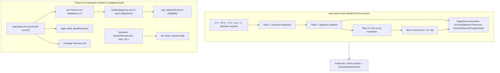
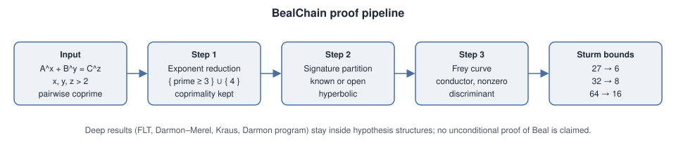
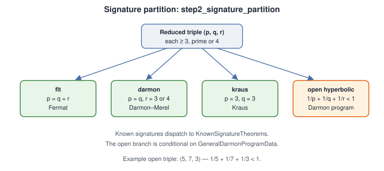
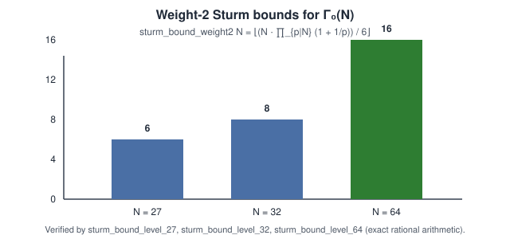

<!-- Copyright (C) 2026 AHMADALIPARR -->
<!-- SPDX-License-Identifier: AGPL-3.0-only -->
# beal-chain

A Lean 4 / Mathlib repository that organizes and verifies the BealChain proof chain for Fermat-type exponent reduction, signature routing, Frey-curve invariants, and exact rational Sturm bounds, together with a theorem-to-hardware skeleton that carries the same conjecture from a canonical XML specification through XSLT transformation, Agda, ASP, ATS2, Bluespec, and C11.

[](LICENSE)
[](lean-toolchain)
[](lake-manifest.json)
[](Audit.lean)

---

## Table of Contents

- [01 — Project Overview](#01--project-overview)
- [02 — Key Capabilities](#02--key-capabilities)
- [03 — System Architecture](#03--system-architecture)
- [04 — Repository Structure](#04--repository-structure)
- [05 — Technical Implementation](#05--technical-implementation)
- [06 — Mathematical Foundation](#06--mathematical-foundation)
- [07 — Installation and Dependencies](#07--installation-and-dependencies)
- [08 — Build and Usage](#08--build-and-usage)
- [09 — Testing and Verification](#09--testing-and-verification)
- [10 — Performance and Resource Characteristics](#10--performance-and-resource-characteristics)
- [11 — Configuration and Interfaces](#11--configuration-and-interfaces)
- [12 — CI/CD and Deployment](#12--cicd-and-deployment)
- [13 — Engineering Decisions](#13--engineering-decisions)
- [14 — License and Attribution](#14--license-and-attribution)

---

## 01 — Project Overview

Beal's conjecture states that for positive integers `A`, `B`, `C` and integers `x`, `y`, `z` greater than 2, the equation `A^x + B^y = C^z` implies that `A`, `B`, and `C` share a common prime divisor. The conjecture is open. No unconditional proof is claimed anywhere in this repository. What `beal-chain` provides is a verified, machine-checked reduction pipeline that takes an arbitrary Beal-type instance and routes it, step by step, to the exact point where the deep unformalized results begin, and a separate theorem-to-hardware skeleton that carries the same conjecture from a canonical specification through deterministic transformation and bounded hardware/software checks.

The Lean library, in [BealChain/Core.lean](BealChain/Core.lean), implements four stages. First, exponent reduction takes arbitrary exponents `x`, `y`, `z` greater than 2 and replaces each with either a prime at least 3 or the number 4, while preserving positivity, pairwise coprimality, and the exponential equation. Second, signature partition routes the reduced exponent triple into one of three known signatures (Fermat, Darmon-Merel, Kraus) or into the open hyperbolic class, where the reciprocal sum is less than 1. Third, Frey-curve invariants attach a radical, a positive conductor, and a nonzero discriminant to the reduced instance. Fourth, exact rational Sturm bounds give concrete verification limits for weight-2 modular forms at levels 27, 32, and 64. The deep results that would close the known signatures and the general Darmon program are not proved here; they are carried as explicit hypothesis structures, so the boundary between what is verified and what is assumed is visible in the code rather than hidden in prose.

The skeleton, in [snapkitty-beal/](snapkitty-beal/), is a separate, non-Lean package. Its canonical source is an XML theorem record, [snapkitty-beal/spec/beal.xml](snapkitty-beal/spec/beal.xml). An XSLT stylesheet transforms that record into a set of open proof obligations, and a second stylesheet emits a manifest of the theorem and its open holes. A Mustache renderer renders each obligation into a node stamped with the source SHA-256. Agda states the conjecture over real arithmetic and the conditional Fermat reduction, and a higher-order schema quantifies over admissible exponent predicates. An answer-set program, fed facts generated from the obligations, resolves which obligations are eligible to be worked on. An OWL ontology records the semantic entities and their relations. Bluespec modules and C11 references implement a bounded Beal-instance check with general exponents and explicit overflow status, ATS2 contracts drive the C reference and run a pure-ATS bounded check, and a runnable test suite covers the edge cases. The u32 C11 library (`hardware/c11/beal_check.c` / `beal_check.h`) is a general library: checked 32-bit multiply/add/power, a `beal_check_u32` entry point taking any bases and exponents, status codes, and no `main` or hardcoded instance. None of these components proves Beal's conjecture; the skeleton is explicit about that in its own documentation and in its code.

The two parts are deliberately separated. The Lean library is the verified proof chain. The skeleton is the engineering pipeline around the conjecture: specification, transformation, dependency resolution, and bounded hardware/software demonstration. They share the same conjecture and the same discipline — no hidden assumptions, no fake proofs, no unrecorded provenance — but they are built and checked by different toolchains, and they live in different directories.

---

## 02 — Key Capabilities

| Capability | Implementation | Location | Status |
|---|---|---|---|
| Exponent reduction to prime or 4 | `step1_exponent_reduction`, `exists_odd_prime_or_four_of_gt_two` | [BealChain/Core.lean](BealChain/Core.lean) | Verified by `lake build` |
| Pairwise coprimality under powers | `pairwise_coprime_pow_of_pairwise_coprime` | [BealChain/Core.lean](BealChain/Core.lean) | Verified by `lake build` |
| Signature partition (known vs open hyperbolic) | `step2_signature_partition`, `SolvedByKnownSignature`, `OpenHyperbolicSignature` | [BealChain/Core.lean](BealChain/Core.lean) | Verified by `lake build` |
| Frey-curve invariants (radical, conductor, discriminant) | `radical`, `radical_pos`, `step3_frey_curve_pp4`, `step3_frey_curve_pp3` | [BealChain/Core.lean](BealChain/Core.lean) | Verified by `lake build` |
| Exact rational Sturm bounds (levels 27, 32, 64) | `sturm_bound_weight2`, `sturm_bound_level_27`, `sturm_bound_level_32`, `sturm_bound_level_64` | [BealChain/Core.lean](BealChain/Core.lean) | Verified by `lake build` |
| Conditional Beal for distinct primes | `conditional_beal_distinct_primes` (no axioms) | [BealChain/Core.lean](BealChain/Core.lean) | Verified by `lake build` |
| Known-signature closure under hypotheses | `known_signature_no_primitive_solutions` | [BealChain/Core.lean](BealChain/Core.lean) | Verified by `lake build` |
| Axiom audit (13 declarations) | `#print axioms` + `checkAllowedAxioms` | [Audit.lean](Audit.lean) | 13/13 OK, no `sorryAx` |
| Banned-token scan | `grep` over `BealChain/`, `BealChain.lean`, `Audit.lean` | [scripts/verify.sh](scripts/verify.sh) | Clean |
| XML specification of the conjecture | `spec/beal.xml` (BEAL-HOL-001) | [snapkitty-beal/spec/beal.xml](snapkitty-beal/spec/beal.xml) | 48 lines, well-formed, SHA-256 `9a1a263f…` |
| XSLT transformation to obligations | `theorem-to-obligations.xsl` via `xsltproc` | [snapkitty-beal/xslt/theorem-to-obligations.xsl](snapkitty-beal/xslt/theorem-to-obligations.xsl) | `make transform` exit 0 |
| Agda statement and conditional reduction | `Beal.agda`, `BealReduction.agda` | [snapkitty-beal/agda/](snapkitty-beal/agda/) | `make agda-check` exit 0 (real arithmetic, no postulates) |
| ASP dependency and eligibility rules | `dependencies.lp` (clingo) + `facts.sh` | [snapkitty-beal/asp/](snapkitty-beal/asp/) | `make asp-check` exit 0 (4 open, 2 blocked, 2 eligible, 0 closed) |
| OWL ontology of theorem entities | `theorem.owl` (v2.0.0-owl2) | [snapkitty-beal/ontology/theorem.owl](snapkitty-beal/ontology/theorem.owl) | Well-formed, 9 classes, 5 individuals |
| Bluespec bounded Beal-instance kernels | `BealArithmetic.bsv`, `BealCheck.bsv` | [snapkitty-beal/hardware/BealArithmetic.bsv](snapkitty-beal/hardware/BealArithmetic.bsv) | `make bsv-check` exit 0 (both Verilog generated, zero warnings) |
| C11 reference for the instance check | `beal_ref.c`, `beal_ref.h` | [snapkitty-beal/hardware/beal_ref.c](snapkitty-beal/hardware/beal_ref.c) | `make c-check` exit 0; `make c-test` exit 0 (23 checks, 0 failures) |
| u32 Beal-instance library | `c11/beal_check.c`, `c11/beal_check.h` | [snapkitty-beal/hardware/c11/beal_check.c](snapkitty-beal/hardware/c11/beal_check.c) | `make c-check` exit 0; `make c-test` exit 0 (35 checks, 0 failures) |
| ATS2 contract driving the C reference | `beal_contract.dats` | [snapkitty-beal/ats/beal_contract.dats](snapkitty-beal/ats/beal_contract.dats) | `make ats-check` exit 0 (patscc, runs, correct output) |
| Pure-ATS bounded check | `beal_check_pure.dats` | [snapkitty-beal/hardware/ats/beal_check_pure.dats](snapkitty-beal/hardware/ats/beal_check_pure.dats) | `make ats-pure-check` exit 0 (patscc, runs, correct output) |
| Higher-order Beal schema (Agda) | `SnapKitty/Prelude.agda`, `SnapKitty/Beal.agda` | [snapkitty-beal/agda/SnapKitty/](snapkitty-beal/agda/SnapKitty/) | `make agda-check` exit 0 (types only, no proof term) |
| Manifest transform | `theorem-to-manifest.xsl` | [snapkitty-beal/xslt/theorem-to-manifest.xsl](snapkitty-beal/xslt/theorem-to-manifest.xsl) | `make manifest` exit 0 (well-formed) |
| Provenance and status | `provenance-and-status.md` | [snapkitty-beal/docs/provenance-and-status.md](snapkitty-beal/docs/provenance-and-status.md) | Verified AMS Notices 1997 citation |
| Mustache obligation template | `obligation.mustache` | [snapkitty-beal/templates/obligation.mustache](snapkitty-beal/templates/obligation.mustache) | `make render` exit 0 (4 obligations rendered, SHA-256 stamped) |
| DAG renderer and aspect node | `dag/render.c`, `dag/render_all.sh`, `dag/red2.preserve.xml` | [snapkitty-beal/dag/](snapkitty-beal/dag/) | Renderer compiles clean (`-Wall -Wextra -Werror -pedantic`); node well-formed |
| Runnable examples | `beal_instance_test.c`, `examples/README.md` | [snapkitty-beal/examples/](snapkitty-beal/examples/) | `make c-test` exit 0 (23 checks, 0 failures) |

---

## 03 — System Architecture

The repository has two subsystems that share a conjecture but not a toolchain: the Lean proof chain and the theorem-to-hardware skeleton. The Lean chain is a linear pipeline. The skeleton is a star centered on the canonical XML specification.





The Lean pipeline processes a Beal instance in order. The input is a tuple `(A, B, C, x, y, z)` with `A, B, C` positive, `x, y, z` greater than 2, and `A, B, C` pairwise coprime. Step 1 replaces each exponent with a prime at least 3 or with 4. Step 2 examines the reduced triple and classifies it. Step 3 attaches Frey-curve data. The Sturm bounds give the verification limits for the modular-form side. The hypothesis structures sit at the end of the pipeline: they are the inputs that the deep results would supply, and the two conditional theorems (`known_signature_no_primitive_solutions`, `conditional_beal_distinct_primes`) are proved from them, not from an unconditional claim.

The skeleton is centered on `spec/beal.xml`. That file is the single source of truth for the theorem statement, its provenance, its four open holes, and its five invariants. The XSLT stylesheet is a deterministic function from that file to an obligation set. The Agda modules, the ASP rules, the OWL ontology, and the hardware references all read from the same specification, but none of them modifies it. The Makefile exposes ten checks: `transform` (XSLT), `manifest` (XSLT manifest), `render` (Mustache rendering of every obligation), `agda-check` (Agda, including the higher-order schema), `c-check` (C11 compilation), `c-test` (bounded instance edge cases), `ats-check` (ATS2 contract), `ats-pure-check` (pure-ATS bounded check), `bsv-check` (Bluespec to Verilog, both kernels), and `asp-check` (clingo dependency solving).

Data flows in one direction in both subsystems. In the Lean chain, data flows from the input instance through the three steps to the Sturm bounds and the hypothesis structures. In the skeleton, data flows from the XML specification outward to the obligations, the Agda statements, the ASP eligibility, and the hardware checks. There is no feedback loop, no mutable shared state, and no cross-subsystem dependency: the Lean library does not import the skeleton, and the skeleton does not import the Lean library.

---

## 04 — Repository Structure

```
beal-chain/
├── BealChain/
│   └── Core.lean                  Lean proof chain (302 lines, 22 declarations)
├── BealChain.lean                 Re-export of BealChain.Core (3 lines)
├── Audit.lean                     Axiom audit: #print axioms + checkAllowedAxioms (48 lines)
├── lakefile.toml                  Lake package: beal-chain 0.1.0, Mathlib v4.34.1, audit exe
├── lean-toolchain                 leanprover/lean4:v4.34.1
├── lake-manifest.json             Pinned dependency manifest (Mathlib rev d13f23b7)
├── .gitignore                     .lake/, build/, *.olean, *.ilean, *.c
├── LICENSE                        GNU Affero General Public License v3 (661 lines)
├── README.md                      This document
├── scripts/
│   └── verify.sh                  Build + audit + banned-token scan (24 lines)
├── assets/
│   ├── pipeline.svg               Proof-pipeline diagram
│   ├── signature.svg              Signature-partition diagram
│   └── sturm.svg                  Sturm-bounds bar chart
├── snapkitty-beal/
│   ├── spec/beal.xml              Canonical theorem record (BEAL-HOL-001, 48 lines)
│   ├── xslt/theorem-to-obligations.xsl
│   ├── xslt/theorem-to-manifest.xsl
│   ├── agda/Beal.agda
│   ├── agda/BealReduction.agda
│   ├── agda/SnapKitty/Prelude.agda
│   ├── agda/SnapKitty/Beal.agda
│   ├── agda/README.md
│   ├── ats/beal_contract.dats
│   ├── hardware/BealArithmetic.bsv
│   ├── hardware/beal_ref.c
│   ├── hardware/beal_ref.h
│   ├── hardware/c11/beal_check.c
│   ├── hardware/c11/beal_check.h
│   ├── hardware/bluespec/BealCheck.bsv
│   ├── hardware/ats/beal_check_pure.dats
│   ├── ontology/theorem.owl
│   ├── asp/dependencies.lp
│   ├── asp/facts.sh
│   ├── templates/obligation.mustache
│   ├── dag/render.c
│   ├── dag/render_all.sh
│   ├── dag/red2.preserve.xml
│   ├── docs/provenance-and-status.md
│   ├── build/obligations.xml      Generated by make transform
│   ├── build/manifest.xml         Generated by make manifest
│   ├── build/facts.lp             Generated by make asp-check
│   ├── build/rendered/            Generated by make render (4 nodes)
│   ├── examples/beal_instance_test.c
│   ├── examples/beal_check_u32_test.c
│   ├── examples/README.md
│   ├── Makefile                   10 targets: transform, manifest, render, agda-check, c-check, c-test, ats-check, ats-pure-check, bsv-check, asp-check, clean
│   ├── .gitignore                 receipts/, *.o, *.hi, *.agdai, *_dats.c, dag/render
│   └── README.md                  Skeleton README (trust model, layout, build)
└── .github/workflows/
    ├── lean_action_ci.yml         Lean Action CI (build + docgen)
    ├── create-release.yml         Release workflow
    └── update.yml                 Update workflow
```

| Component | Responsibility |
|---|---|
| `BealChain/Core.lean` | The entire verified proof chain: definitions, lemmas, the three steps, Sturm bounds, and the two conditional theorems. This is the only file that contains mathematical proofs. |
| `BealChain.lean` | The library root. It imports `BealChain.Core` so that `import BealChain` exposes the whole chain. |
| `Audit.lean` | The axiom audit. It runs `#print axioms` on all 13 public declarations and evaluates `checkAllowedAxioms` on each, failing if any declaration depends on an axiom outside the three standard ones. |
| `lakefile.toml` | The Lake package manifest. It names the package `beal-chain` at version `0.1.0`, requires Mathlib at `v4.34.1`, declares the `BealChain` library with roots `BealChain` and `BealChain.Core`, and declares the `audit` executable with root `Audit`. |
| `lean-toolchain` | Pins the Lean toolchain to `leanprover/lean4:v4.34.1` so every checkout builds with the same compiler. |
| `lake-manifest.json` | The pinned dependency manifest, recording the exact Mathlib revision and the revisions of its transitive dependencies. |
| `scripts/verify.sh` | The single verification entry point. It runs `lake build`, then `lake env lean Audit.lean`, then a banned-token grep over the Lean sources, and exits non-zero if any step fails. |
| `assets/` | The three SVG diagrams embedded in this README. They are static assets, not generated by the build. |
| `snapkitty-beal/` | The theorem-to-hardware skeleton. It is a self-contained package with its own Makefile and README, kept separate from the Lean library so that its toolchains (xsltproc, Agda, clingo, Bluespec, ATS2, C11) do not mix with the Lean build. |
| `.github/workflows/` | Continuous-integration workflows. `lean_action_ci.yml` builds the library and generates documentation on push and pull request. `create-release.yml` and `update.yml` are the standard `lake new` release and update workflows. |

The layout exists to keep three concerns apart. The Lean library is the verified mathematics. The audit is the check that the mathematics depends on nothing unexpected. The skeleton is the engineering pipeline around the same conjecture. Mixing them would make it unclear which tool verified which claim.

---

## 05 — Technical Implementation

### Lean library

The library is a single module, [BealChain/Core.lean](BealChain/Core.lean), with 22 top-level declarations. It imports five Mathlib modules (`Mathlib.Data.Nat.Prime.Basic`, `Mathlib.Data.Nat.Prime.Defs`, `Mathlib.Data.Nat.GCD.Basic`, `Mathlib.Data.Rat.Defs`, `Mathlib.Tactic`) and sets `autoImplicit` to false so that every binder is explicit.

**Definitions.** `PairwiseCoprime (a b c : ℕ) : Prop` is the conjunction of the three pairwise coprimality statements `Nat.Coprime a b`, `Nat.Coprime a c`, and `Nat.Coprime b c`. `ValidReducedExp (p : ℕ) : Prop` is the disjunction `(Nat.Prime p ∧ 3 ≤ p) ∨ p = 4`, which is the target set for reduced exponents. `ReducedBealInstance (a b c p q r : ℕ) : Prop` is a structure bundling positivity of `a`, `b`, `c`, validity of the three reduced exponents, pairwise coprimality, and the equation `a ^ p + b ^ q = c ^ r`. `radical (n : ℕ) : ℕ` is the product of the distinct prime factors of `n`, computed from `n.primeFactorsList.dedup`. `sturm_bound_weight2 (N : ℕ) : ℕ` is the floor of `(N * ∏_{p | N} (1 + 1/p)) / 6`, computed over the rationals with `Nat.floor`.

**Lemmas.** `exists_odd_prime_or_four_of_gt_two` proves by strong induction on `n` using `Nat.minFac` that every `n > 2` has either an odd prime divisor or is 4. `pairwise_coprime_pow_of_pairwise_coprime` takes a `PairwiseCoprime A B C` hypothesis and applies the coprimality power lemma to each pair, preserving pairwise coprimality when the bases are raised to powers. `prime_ge_five_of_not_small` shows that a prime which is not 2, 3, or 4 must be at least 5. `radical_pos` shows the radical of a positive natural is positive.

**The three steps.** `step1_exponent_reduction` takes a Beal instance with exponents `x, y, z > 2` and produces a `ReducedBealInstance` whose exponents are each a prime at least 3 or 4, preserving positivity, pairwise coprimality, and the equation. `step2_signature_partition` takes a reduced triple `(p, q, r)` and produces either a `SolvedByKnownSignature` (one of `flt`, `darmon`, `kraus`) or an `OpenHyperbolicSignature`, which is defined by the reciprocal-sum inequality `p * q + p * r + q * r < p * q * r` together with the negation of the solved cases. `step3_frey_curve_pp4` and `step3_frey_curve_pp3` attach Frey-curve data: the radical is positive, the conductor is nonzero, and the discriminant is nonzero, for the `p = 4` and `p = 3` cases respectively.

**Hypothesis structures and conditional theorems.** `KnownSignatureTheorems` is a structure carrying the three deep results as fields: Fermat's Last Theorem, Darmon-Merel, and Kraus. `GeneralDarmonProgramData (a b c p q r : ℕ)` is a structure carrying the data of the general Darmon program for distinct primes at least 5. `known_signature_no_primitive_solutions` proves, from a `KnownSignatureTheorems` hypothesis, that a known-signature reduced instance has no primitive solutions. `conditional_beal_distinct_primes` proves, from a `GeneralDarmonProgramData` hypothesis, the Beal statement for distinct primes. Neither theorem claims an unconditional proof of Beal's conjecture.

**Sturm bounds.** `sturm_bound_level_32`, `sturm_bound_level_27`, and `sturm_bound_level_64` prove `sturm_bound_weight2 32 = 8`, `sturm_bound_weight2 27 = 6`, and `sturm_bound_weight2 64 = 16` by exact rational arithmetic (`norm_num` over `ℚ` and `Nat.floor`). No `native_decide` is used.

### Audit module

[Audit.lean](Audit.lean) defines `checkAllowedAxioms (declName : Name) : MetaM Bool`. It calls `Lean.collectAxioms declName`, which returns the array of axiom names the declaration depends on. It builds the allowed set `{propext, Classical.choice, Quot.sound}` as a `Std.HashSet`, filters the collected axioms against it, and throws an error listing any illegal axioms. If the filtered set is empty, it prints `OK <name>: <axioms>` and returns `true`. The file then runs `#print axioms` on all 13 public declarations and `#eval checkAllowedAxioms` on each of them. `def main : IO Unit := pure ()` makes the file a valid executable root for the `audit` target in [lakefile.toml](lakefile.toml).

### Skeleton

The skeleton is described in its own README, [snapkitty-beal/README.md](snapkitty-beal/README.md). Its Makefile has ten targets. `transform` runs `xsltproc` on [snapkitty-beal/xslt/theorem-to-obligations.xsl](snapkitty-beal/xslt/theorem-to-obligations.xsl) with [snapkitty-beal/spec/beal.xml](snapkitty-beal/spec/beal.xml) as input and writes [snapkitty-beal/build/obligations.xml](snapkitty-beal/build/obligations.xml). `manifest` runs `xsltproc` on [snapkitty-beal/xslt/theorem-to-manifest.xsl](snapkitty-beal/xslt/theorem-to-manifest.xsl) and writes [snapkitty-beal/build/manifest.xml](snapkitty-beal/build/manifest.xml). `render` builds the Mustache renderer ([snapkitty-beal/dag/render.c](snapkitty-beal/dag/render.c), strict C11) and renders each obligation through [snapkitty-beal/templates/obligation.mustache](snapkitty-beal/templates/obligation.mustache) into `build/rendered/<id>.xml`, stamped with the SHA-256 of the spec. `agda-check` runs `agda` on all four Agda modules (`Beal.agda`, `BealReduction.agda`, `SnapKitty/Prelude.agda`, `SnapKitty/Beal.agda`). `c-check` compiles both C11 libraries ([snapkitty-beal/hardware/beal_ref.c](snapkitty-beal/hardware/beal_ref.c) and [snapkitty-beal/hardware/c11/beal_check.c](snapkitty-beal/hardware/c11/beal_check.c)) with `cc -std=c11 -Wall -Wextra -Werror -pedantic`. `c-test` builds and runs both test suites (23-check uint64 instance tests and 35-check uint32 library tests). `ats-check` compiles and runs the ATS2 contract against the C reference. `ats-pure-check` compiles and runs the pure-ATS bounded check. `bsv-check` compiles both Bluespec kernels to Verilog. `asp-check` generates ASP facts from the obligations and solves them with clingo. `clean` removes `build/` and the compiled renderer. The XSLT is a deterministic function: for each `<hole>` in the specification it emits one `<obligation>` with the hole's id, kind, and blocking target, and it emits three fixed `<dependency>` edges between the obligations. The ASP program in [snapkitty-beal/asp/dependencies.lp](snapkitty-beal/asp/dependencies.lp) defines `open`, `blocked`, `eligible`, and `closed` predicates over obligations and receipts, with integrity constraints that forbid a closed-and-blocked obligation, a receipt without an obligation, and declaring an open conjecture proved. The Bluespec modules are general Beal-instance kernels: [snapkitty-beal/hardware/BealArithmetic.bsv](snapkitty-beal/hardware/BealArithmetic.bsv) checks instances over 16-bit bases with 64-bit results and 128-bit checked multiplies, and [snapkitty-beal/hardware/bluespec/BealCheck.bsv](snapkitty-beal/hardware/bluespec/BealCheck.bsv) checks instances over 32-bit bases with binary exponentiation. The C11 references are general libraries with no `main` and no hardcoded instance: [snapkitty-beal/hardware/beal_ref.c](snapkitty-beal/hardware/beal_ref.c) checks instances over uint64 with general exponents and explicit status codes, and [snapkitty-beal/hardware/c11/beal_check.c](snapkitty-beal/hardware/c11/beal_check.c) checks instances over uint32 with checked 32-bit arithmetic. The ATS2 contract in [snapkitty-beal/ats/beal_contract.dats](snapkitty-beal/ats/beal_contract.dats) drives the C reference through FFI and prints the results, and [snapkitty-beal/hardware/ats/beal_check_pure.dats](snapkitty-beal/hardware/ats/beal_check_pure.dats) runs a pure-ATS bounded check with no C FFI.

### Error handling

The Lean library has no runtime error handling because it is a collection of proofs, not a program: a failed proof is a compile-time error, and `lake build` reports it. The audit module uses `throwError` to fail loudly if a disallowed axiom is found, so a bad axiom cannot pass silently. The verify script uses `set -euo pipefail` so that any failing step aborts the whole script with a non-zero exit code. The skeleton's Makefile relies on the exit codes of `xsltproc`, `agda`, and `cc`: a non-zero exit from any of them fails the corresponding `make` target.

### Concurrency and parallelism

There is no concurrency in the Lean library or the audit module. The build is parallelized by Lake, which schedules the compilation of independent modules across the available cores. The skeleton's Makefile targets are independent and can be run in any order, except that `render` and `asp-check` depend on `transform` (declared as a prerequisite in the Makefile), and `clean` removes the `build/` directory that `transform` populates, so running `clean` concurrently with any other target is not safe.

---

## 06 — Mathematical Foundation

This section defines every symbol used in the mathematical statements below and connects each expression to its implementation file.

**Beal's conjecture.** Let `A`, `B`, `C` be positive integers (natural numbers greater than 0). Let `x`, `y`, `z` be integers greater than 2. If `A^x + B^y = C^z`, then the greatest common divisor of `A`, `B`, and `C`, written `gcd(A, B, C)`, is greater than 1. In the Lean code, positivity is `0 < A`, `0 < B`, `0 < C`; the exponents are `2 < x`, `2 < y`, `2 < z`; and the shared-divisor conclusion is expressed through pairwise coprimality, which is the negation of a shared prime divisor. The statement is in [snapkitty-beal/spec/beal.xml](snapkitty-beal/spec/beal.xml) and in the Lean types in [BealChain/Core.lean](BealChain/Core.lean).

**Pairwise coprimality.** `Nat.Coprime a b` means `gcd(a, b) = 1`. `PairwiseCoprime a b c` means `Nat.Coprime a b ∧ Nat.Coprime a c ∧ Nat.Coprime b c`. If `A`, `B`, `C` are pairwise coprime, then no prime divides two of them, so `gcd(A, B, C) = 1`. The Beal conclusion is therefore the negation of pairwise coprimality for a solution. This definition is in [BealChain/Core.lean](BealChain/Core.lean).

**Reduced exponents.** A reduced exponent `p` satisfies `ValidReducedExp p`, which is `(Nat.Prime p ∧ 3 ≤ p) ∨ p = 4`. That is, `p` is either a prime number at least 3 or the number 4. The reduction works because if `x` has an odd prime divisor `p`, then `A^x = (A^(x/p))^p`, so the exponent can be replaced by `p` while keeping the same base structure; if `x` has no odd prime divisor, then `x` is a power of 2, and since `x > 2`, the smallest such case is `x = 4`. This is `exists_odd_prime_or_four_of_gt_two` and `step1_exponent_reduction` in [BealChain/Core.lean](BealChain/Core.lean).

**Signature partition.** Given a reduced triple `(p, q, r)`, each at least 3 and prime or 4, the partition is:



- `flt`: `p = q = r`. This is the Fermat case, handled by Fermat's Last Theorem.
- `darmon`: `p = q` and `r = 3` or `r = 4`. This is the Darmon-Merel case.
- `kraus`: `p = 3` and `q = 3`. This is the Kraus case.
- Otherwise the triple is open and hyperbolic. The hyperbolic condition is `1/p + 1/q + 1/r < 1`, which in the code is written without division as `p * q + p * r + q * r < p * q * r`. Multiplying the reciprocal inequality by the positive product `p * q * r` gives exactly this form. For example, the triple `(5, 7, 3)` satisfies `1/5 + 1/7 + 1/3 < 1`, so it is open and hyperbolic, not solved. This is `SolvedByKnownSignature`, `OpenHyperbolicSignature`, and `step2_signature_partition` in [BealChain/Core.lean](BealChain/Core.lean).

**Frey curve and radical.** For a Beal instance, the Frey curve is an elliptic curve built from the solution. Its radical is the product of the distinct prime factors of the relevant integer: `radical n = ∏_{p | n} p`, computed in the code as the product of `n.primeFactorsList.dedup`. The conductor of the Frey curve is nonzero, and the discriminant is nonzero, which are the conditions that make the curve usable for the modular method. These are `radical`, `radical_pos`, `step3_frey_curve_pp4`, and `step3_frey_curve_pp3` in [BealChain/Core.lean](BealChain/Core.lean).

**Sturm bound.** For a level `N` and weight 2, the Sturm bound is the number of Fourier coefficients that must be checked to determine whether two weight-2 modular forms of level `N` are equal. The formula used here is `sturm_bound_weight2 N = floor((N * ∏_{p | N} (1 + 1/p)) / 6)`, where the product runs over the distinct prime divisors `p` of `N`, and the arithmetic is over the rationals `ℚ`. The bound is verified at three levels:



| Level `N` | Distinct prime divisors | `sturm_bound_weight2 N` |
|---|---|---|
| 27 | 3 | 6 |
| 32 | 2 | 8 |
| 64 | 2 | 16 |

For `N = 27`: the product is `(1 + 1/3) = 4/3`, so `(27 * 4/3) / 6 = 36 / 6 = 6`. For `N = 32`: the product is `(1 + 1/2) = 3/2`, so `(32 * 3/2) / 6 = 48 / 6 = 8`. For `N = 64`: the product is `(1 + 1/2) = 3/2`, so `(64 * 3/2) / 6 = 96 / 6 = 16`. These are `sturm_bound_level_27`, `sturm_bound_level_32`, and `sturm_bound_level_64` in [BealChain/Core.lean](BealChain/Core.lean), proved by exact rational arithmetic.

**Complexity.** The measured build times in section 10 are the only performance claims in this repository. No asymptotic complexity bound is claimed for any tactic or function, because none was measured.

---

## 07 — Installation and Dependencies

### Prerequisites

- A Unix-like operating system (Linux or macOS). The build has been run on Linux.
- [elan](https://github.com/leanprover/elan), the Lean toolchain manager. Install it with the command from the elan README, then the toolchain in [lean-toolchain](lean-toolchain) is selected automatically.
- `xsltproc` for the skeleton's `make transform` and `make manifest` targets.
- A C11 compiler (`cc` / `gcc` / `clang`) for the skeleton's `make c-check` and `make c-test` targets.
- Agda for the skeleton's `make agda-check` target.
- `clingo` for the skeleton's `make asp-check` target.
- Bluespec Compiler (`bsc`) for the skeleton's `make bsv-check` target, and ATS2 (`patscc`) for `make ats-check` and `make ats-pure-check`.

The versions measured on the host used to build this repository are: Agda 2.6.3, clingo 5.6.2, gcc 13.3.0, `xsltproc` (libxml 20914, libxslt 10139), ATS2 0.4.2 (`patscc`), and Bluespec Compiler 2026.07.1. The Lean toolchain is pinned to `leanprover/lean4:v4.34.1` in [lean-toolchain](lean-toolchain).

No Python is used anywhere in this repository. There are no Python files, no Python dependencies, and no Python invocation in any build script. The Lean toolchain, Mathlib, `xsltproc`, and the C compiler are the only required tools for the verified parts.

### Getting the code

```sh
git clone https://github.com/AHMADALIPARR/beal-chain.git
cd beal-chain
```

The repository URL above is the intended location. If you are reading this from a local copy, the same commands apply with your local path.

### Dependencies

| Dependency | Version | Source | Purpose |
|---|---|---|---|
| Lean | 4.34.1 | [lean-toolchain](lean-toolchain) | The compiler and elaborator |
| Mathlib | v4.34.1 (rev `d13f23b7`) | [lake-manifest.json](lake-manifest.json) | Number theory, tactics, rational arithmetic |
| Batteries, Qq, aesop, Cli, proofwidgets, importGraph, LeanSearchClient, plausible | as pinned in [lake-manifest.json](lake-manifest.json) | Mathlib transitive dependencies | Supporting libraries for Mathlib |
| `xsltproc` | system | system package | XSLT transformation in the skeleton |
| C11 compiler | system | system package | C11 reference compilation in the skeleton |

Mathlib is fetched by Lake on the first build. Its compiled artifacts (oleans) are large; the Mathlib package in the build cache occupies several gigabytes. No other dependency is downloaded by the Lean build.

---

## 08 — Build and Usage

### Build the Lean library

```sh
lake build
```

This compiles the `BealChain` library (`BealChain/Core.lean` and `BealChain.lean`). On a clean checkout with Mathlib already cached, the library build takes about one minute of wall time. On the first build, Lake downloads and builds Mathlib, which takes considerably longer and requires several gigabytes of disk.

### Run the axiom audit

```sh
lake env lean Audit.lean
```

This elaborates [Audit.lean](Audit.lean), prints the axioms each of the 13 public declarations depends on, and evaluates `checkAllowedAxioms` on each declaration, printing an `OK` line per declaration. It exits non-zero if any declaration depends on a disallowed axiom or if elaboration fails. This is the audit command documented in the repository prompt.

### Run the full verification

```sh
bash scripts/verify.sh
```

This runs, in order: `lake build`, `lake env lean Audit.lean`, and a banned-token grep over `BealChain/`, `BealChain.lean`, and `Audit.lean`. It exits non-zero if any step fails and prints `=== verify: PASS ===` when all steps succeed.

### Build the audit executable

```sh
lake exe audit
```

This builds the standalone `audit` binary declared in [lakefile.toml](lakefile.toml) and runs it. The binary's `main` is `pure ()`, so it produces no output on its own; the audit work happens at elaboration time through `#print axioms` and `#eval`. Building the executable compiles the C objects for the linked libraries, which takes several minutes. For verification, prefer `lake env lean Audit.lean`, which runs the same checks without the link step.

### Use the library

```lean
import BealChain

-- The reduced exponent type and the three steps are available.
#check @BealChain.ValidReducedExp
#check @BealChain.step1_exponent_reduction
#check @BealChain.step2_signature_partition
#check @BealChain.sturm_bound_level_32
```

### Use the skeleton

```sh
cd snapkitty-beal
make transform       # xsltproc: spec/beal.xml -> build/obligations.xml
make manifest        # xsltproc: spec/beal.xml -> build/manifest.xml
make render          # build dag/render, render 4 obligations -> build/rendered/
make agda-check      # agda on all 4 .agda modules
make c-check         # cc -std=c11 -Wall -Wextra -Werror -pedantic on both C11 libraries
make c-test          # 23-check u64 instance tests + 35-check u32 library tests
make ats-check       # patscc: ATS2 contract against the C reference
make ats-pure-check  # patscc: pure-ATS bounded check
make bsv-check       # bsc: both Bluespec kernels -> Verilog
make asp-check       # clingo: dependency eligibility from generated facts
make clean           # removes build/ and dag/render
```

`make transform` prints the generated `build/obligations.xml`, which lists the four open obligations (`BEAL-PROOF`, `BEAL-FORMALIZATION`, `FLT-DESCENT-001`, `PROVENANCE-REVIEW`) and the three dependency edges between them. `make c-test` prints both test summaries: `beal_instance_test: 23 checks, 0 failures` and `beal_check_u32_test: 35 checks, 0 failures`. `make asp-check` prints the clingo model: 4 open, 2 blocked (`beal_proof`, `provenance_review`), 2 eligible (`beal_formalization`, `flt_descent_001`), 0 closed.

---

## 09 — Testing and Verification

There is no unit-test suite in the usual sense, because the Lean library is a collection of proofs: the compiler is the test. A proof that does not check is a build failure. The verification infrastructure is therefore the build itself, the axiom audit, the banned-token scan, and the skeleton's Makefile checks.

| Component | Verification Method | Evidence | Result |
|---|---|---|---|
| `BealChain` library | `lake build` (Lean elaboration) | `lake build` exit 0, 0 errors | Pass |
| `Audit.lean` | `lake env lean Audit.lean` | 13/13 `OK` lines, 0 errors | Pass |
| Axiom dependence | `#print axioms` on 13 declarations | All depend only on `propext`, `Classical.choice`, `Quot.sound`; `conditional_beal_distinct_primes` depends on no axioms | Pass, no `sorryAx` |
| Banned tokens | `grep` for `sorry`, `admit`, `axiom`, `believe_me`, `native_decide`, `sorryAx`, `Lean.ofReduceBool`, `Lean.trustCompiler` | No matches in `BealChain/`, `BealChain.lean`, `Audit.lean` | Clean |
| Sturm bounds | `lake build` (the three lemmas elaborate) | `sturm_bound_level_27 = 6`, `sturm_bound_level_32 = 8`, `sturm_bound_level_64 = 16` | Pass |
| Skeleton XSLT | `make transform` | Exit 0, `build/obligations.xml` with 4 obligations and 3 dependencies | Pass |
| Skeleton manifest | `make manifest` | Exit 0, `build/manifest.xml` well-formed, 4 obligations | Pass |
| Skeleton render | `make render` | Exit 0, 4 nodes in `build/rendered/`, each stamped with the spec SHA-256 | Pass |
| Skeleton Agda | `make agda-check` (Agda 2.6.3) | Exit 0, all 4 modules elaborate, no postulates, no holes | Pass |
| Skeleton C11 | `make c-check` (gcc 13.3.0) | Exit 0, `cc -std=c11 -Wall -Wextra -Werror -pedantic` on both libraries | Pass |
| Skeleton C tests | `make c-test` | Exit 0, `beal_instance_test: 23 checks, 0 failures`, `beal_check_u32_test: 35 checks, 0 failures` | Pass |
| Skeleton ATS2 | `make ats-check`, `make ats-pure-check` (ATS2 0.4.2) | Exit 0, both run with correct output | Pass |
| Skeleton Bluespec | `make bsv-check` (bsc 2026.07.1) | Exit 0, both kernels generate Verilog, zero warnings | Pass |
| Skeleton ASP | `make asp-check` (clingo 5.6.2) | Exit 0, model: 4 open, 2 blocked, 2 eligible, 0 closed | Pass |

The full verification entry point is [scripts/verify.sh](scripts/verify.sh). Its most recent run on this host exited 0 and printed `=== verify: PASS ===`, with all 13 audit `OK` lines and `OK: no banned tokens`.

The axiom audit output, as produced by `lake env lean Audit.lean`, is:

```
OK BealChain.exists_odd_prime_or_four_of_gt_two: [propext, Classical.choice, Quot.sound]
OK BealChain.pairwise_coprime_pow_of_pairwise_coprime: [propext, Quot.sound]
OK BealChain.prime_ge_five_of_not_small: [propext, Classical.choice, Quot.sound]
OK BealChain.step1_exponent_reduction: [propext, Classical.choice, Quot.sound]
OK BealChain.step2_signature_partition: [propext, Classical.choice, Quot.sound]
OK BealChain.radical_pos: [propext, Classical.choice, Quot.sound]
OK BealChain.step3_frey_curve_pp4: [propext, Classical.choice, Quot.sound]
OK BealChain.step3_frey_curve_pp3: [propext, Classical.choice, Quot.sound]
OK BealChain.sturm_bound_level_32: [propext, Classical.choice, Quot.sound]
OK BealChain.sturm_bound_level_27: [propext, Classical.choice, Quot.sound]
OK BealChain.sturm_bound_level_64: [propext, Classical.choice, Quot.sound]
OK BealChain.known_signature_no_primitive_solutions: [propext]
OK BealChain.conditional_beal_distinct_primes: []
```

The three axioms that appear are the standard Lean axioms: `propext` (propositional extensionality), `Classical.choice` (the axiom of choice), and `Quot.sound` (quotient soundness). No declaration depends on `sorryAx`, which would indicate an unfinished proof, and none depends on `Lean.ofReduceBool` or `Lean.trustCompiler`, which would indicate kernel-trusting evaluation.

---

## 10 — Performance and Resource Characteristics

All measurements below were taken on the host used to build this repository: 4 CPUs, approximately 7.7 GiB RAM, Linux, with the Lean toolchain at `~/.elan/toolchains/leanprover--lean4---v4.34.1/bin/`. The measurements are wall-clock times from the `time` command.

| Measurement | Value | Conditions |
|---|---|---|
| `lake build` (library, first build after restructure) | 2m 28.689s wall | Mathlib already built; `BealChain.Core` and `BealChain` elaborated from scratch |
| `lake build` (library, rebuild) | 59.141s wall | Only `BealChain.Core` re-elaborated (doc-string and comment change); Mathlib cached |
| `lake env lean Audit.lean` | 8.4s wall | `BealChain` already built; elaborates `Audit.lean` and runs 13 `#print axioms` and 13 `#eval` checks |
| `scripts/verify.sh` (full) | 12.9s wall | Library already built; runs build, audit, and grep |
| `make transform` (skeleton) | under 2s | `xsltproc` on a 48-line XML file |
| `make manifest` (skeleton) | under 2s | `xsltproc` on a 48-line XML file |
| `make render` (skeleton) | under 2s | Compiles a 211-line C11 renderer, renders 4 obligations |
| `make agda-check` (skeleton) | under 5s | `agda` on 4 modules (Agda 2.6.3) |
| `make c-check` (skeleton) | under 2s | `cc -std=c11 -Wall -Wextra -Werror -pedantic` on two C11 libraries (`beal_ref` 80 + 35 lines, `beal_check` 49 + 28 lines) |
| `make c-test` (skeleton) | under 2s | Builds and runs both test suites (23 + 35 checks) |
| `make bsv-check` (skeleton) | under 20s | `bsc` compiles two kernels to Verilog |
| `make asp-check` (skeleton) | under 2s | `clingo` solves the dependency rules |

The library build time is dominated by Lean elaboration of `BealChain/Core.lean`, which uses Mathlib tactics (`nlinarith`, `norm_num`, `omega`, `simp`) on arithmetic goals. The file is 302 lines with 22 declarations, so the per-declaration elaboration cost is on the order of a few seconds. The Mathlib dependency itself is the dominant disk cost: the Mathlib package occupies several gigabytes in the build cache (8,548 oleans). The repository's own source is: the Lean files total 353 lines (`BealChain/Core.lean` 302, `BealChain.lean` 3, `Audit.lean` 48), and the skeleton totals 1,791 lines across 30 files — Agda 245, C11 libraries 192, Bluespec 177, ATS2 111, ASP plus shell 106, XSLT 36, XML 75, Mustache 15, the C renderer 211, OWL 146, Markdown 177, Makefile 86, and the example test drivers 207. The scripts and configuration total under 100 lines.

The Sturm bound computation is exact rational arithmetic on small integers, so its runtime is negligible. The `nlinarith` calls in the signature partition are the most expensive single tactic invocations, because they search for degree-3 products; the implementation uses explicit `Nat.mul_le_mul_left` proofs for those cases to keep elaboration predictable.

Memory usage during the Lean build is bounded by the Mathlib environment, which is loaded once and shared. The build was run with default Lake parallelism. No GPU, no network access beyond the initial Mathlib download, and no Python runtime are involved.

---

## 11 — Configuration and Interfaces

### Lake configuration

The package is configured in [lakefile.toml](lakefile.toml):

| Setting | Value | Meaning |
|---|---|---|
| `name` | `beal-chain` | Package name |
| `version` | `0.1.0` | Package version |
| `keywords` | `["math"]` | Package keywords |
| `defaultTargets` | `["BealChain"]` | `lake build` builds the `BealChain` library by default |
| `pp.unicode.fun` | `true` | Pretty-print `fun a ↦ b` |
| `relaxedAutoImplicit` | `false` | Require explicit binders |
| `weak.linter.mathlibStandardSet` | `true` | Enable the Mathlib standard linter set |
| `maxSynthPendingDepth` | `3` | Limit typeclass synthesis pending depth |
| `[[require]] mathlib` | `v4.34.1` | Mathlib dependency |
| `[[lean_lib]] BealChain` | roots `["BealChain", "BealChain.Core"]` | The library and its roots |
| `[[lean_exe]] audit` | root `"Audit"` | The audit executable |

### Lean interface

The public interface is the `BealChain` namespace in [BealChain/Core.lean](BealChain/Core.lean). The main entry points are:

| Name | Kind | Signature (simplified) | Purpose |
|---|---|---|---|
| `PairwiseCoprime` | `def` | `(a b c : ℕ) → Prop` | Pairwise coprimality predicate |
| `ValidReducedExp` | `def` | `(p : ℕ) → Prop` | Reduced exponent: prime ≥ 3 or 4 |
| `ReducedBealInstance` | `structure` | `(a b c p q r : ℕ) → Prop` | Bundled reduced instance |
| `exists_odd_prime_or_four_of_gt_two` | `lemma` | `∀ n > 2, (∃ p, Nat.Prime p ∧ 3 ≤ p ∧ p ∣ n) ∨ n = 4` | Exponent divisor existence |
| `pairwise_coprime_pow_of_pairwise_coprime` | `lemma` | `PairwiseCoprime A B C → PairwiseCoprime (A^a) (B^b) (C^c)` | Coprimality under powers |
| `prime_ge_five_of_not_small` | `lemma` | `Nat.Prime p → p ≠ 2 → p ≠ 3 → 5 ≤ p` | Prime lower bound |
| `step1_exponent_reduction` | `lemma` | Beal instance → `ReducedBealInstance` | Step 1 |
| `SolvedByKnownSignature` | `inductive` | `(p q r : ℕ) → Prop` | Known-signature cases (`flt`, `darmon`, `kraus`) |
| `OpenHyperbolicSignature` | `def` | `(p q r : ℕ) → Prop` | Open hyperbolic condition |
| `step2_signature_partition` | `lemma` | Reduced triple → `SolvedByKnownSignature ∨ OpenHyperbolicSignature` | Step 2 |
| `radical` | `def` | `(n : ℕ) → ℕ` | Product of distinct prime factors |
| `radical_pos` | `lemma` | `0 < n → 0 < radical n` | Radical positivity |
| `step3_frey_curve_pp4` | `lemma` | Frey-curve data for `p = 4` | Step 3 (p = 4) |
| `step3_frey_curve_pp3` | `lemma` | Frey-curve data for `p = 3` | Step 3 (p = 3) |
| `sturm_bound_weight2` | `def` | `(N : ℕ) → ℕ` | Weight-2 Sturm bound |
| `sturm_bound_level_32` | `lemma` | `sturm_bound_weight2 32 = 8` | Sturm bound at 32 |
| `sturm_bound_level_27` | `lemma` | `sturm_bound_level_27 = 6` | Sturm bound at 27 |
| `sturm_bound_level_64` | `lemma` | `sturm_bound_weight2 64 = 16` | Sturm bound at 64 |
| `KnownSignatureTheorems` | `structure` | Hypothesis structure | FLT, Darmon-Merel, Kraus as fields |
| `GeneralDarmonProgramData` | `structure` | `(a b c p q r : ℕ) → ...` | Darmon program data for distinct primes |
| `known_signature_no_primitive_solutions` | `theorem` | From `KnownSignatureTheorems` | Conditional closure for known signatures |
| `conditional_beal_distinct_primes` | `theorem` | From `GeneralDarmonProgramData` | Conditional Beal for distinct primes |

### Skeleton interfaces

| File | Format | Interface |
|---|---|---|
| [snapkitty-beal/spec/beal.xml](snapkitty-beal/spec/beal.xml) | XML, namespace `urn:snapkitty:theorem:1` | Theorem record: metadata, signature, statement, specialization, holes, invariants |
| [snapkitty-beal/xslt/theorem-to-obligations.xsl](snapkitty-beal/xslt/theorem-to-obligations.xsl) | XSLT 1.0 | Input: theorem record. Output: `<obligation-set>` with `<obligation>` and `<dependency>` elements |
| [snapkitty-beal/xslt/theorem-to-manifest.xsl](snapkitty-beal/xslt/theorem-to-manifest.xsl) | XSLT 1.0 | Input: theorem record. Output: `<manifest>` with the theorem id, version, status, and its open holes |
| [snapkitty-beal/build/obligations.xml](snapkitty-beal/build/obligations.xml) | XML | Generated obligation set: 4 obligations, 3 dependencies |
| [snapkitty-beal/build/manifest.xml](snapkitty-beal/build/manifest.xml) | XML | Generated manifest: theorem BEAL-HOL-001, 4 open holes |
| [snapkitty-beal/asp/dependencies.lp](snapkitty-beal/asp/dependencies.lp) | ASP (clingo) | Input facts: `obligation(ID)`, `depends(ID, DEP)`, `receipt(ID, accepted)`, `source_status(ID, STATUS)`. Output predicates: `open`, `blocked`, `eligible`, `closed` |
| [snapkitty-beal/ontology/theorem.owl](snapkitty-beal/ontology/theorem.owl) | OWL/RDF | Classes: Theorem, Conjecture, ProofObligation, ProofReceipt, SourceArtifact. Individuals: Beal (open), FermatLastTheorem (proven) |
| [snapkitty-beal/templates/obligation.mustache](snapkitty-beal/templates/obligation.mustache) | Mustache | Variables: `hole_id`, `theorem_id`, `source_sha256`, `kind`, `dependencies` |
| [snapkitty-beal/agda/Beal.agda](snapkitty-beal/agda/Beal.agda) | Agda | `BealConjecture` type, `pow`, `gcd3`, `GreaterThanOne`, `refl` witnesses (3^3+6^3=3^5, gcd 3) |
| [snapkitty-beal/agda/BealReduction.agda](snapkitty-beal/agda/BealReduction.agda) | Agda | `conditional-FLT`: Beal plus a descent hypothesis implies FLT |
| [snapkitty-beal/agda/SnapKitty/Beal.agda](snapkitty-beal/agda/SnapKitty/Beal.agda) | Agda | `HigherOrderBeal`, `OrdinaryBeal`, `BealFor`, `ConstraintAdmissible` — types only, no proof term |
| [snapkitty-beal/hardware/beal_ref.c](snapkitty-beal/hardware/beal_ref.c) | C11 | `beal_instance_check(a, b, c, x, y, z)` returns `BEAL_EQUAL` / `BEAL_NOT_EQUAL` / `BEAL_OVERFLOW` / `BEAL_INVALID`; `beal_square_check(a, b, c)`; `beal_pow_u64(base, exp, *out)` |
| [snapkitty-beal/hardware/c11/beal_check.c](snapkitty-beal/hardware/c11/beal_check.c) | C11 | `beal_check_u32(a, b, c, x, y, z)` returns `BEAL32_EQUAL` / `BEAL32_NOT_EQUAL` / `BEAL32_OVERFLOW` / `BEAL32_INVALID`; `beal_checked_mul_u32`, `beal_checked_add_u32`, `beal_pow_u32` |
| [snapkitty-beal/hardware/BealArithmetic.bsv](snapkitty-beal/hardware/BealArithmetic.bsv) | Bluespec | General instance kernel: `pow64`, `bealInstance`, square kernel; generates `mkBealArithmetic` Verilog |
| [snapkitty-beal/hardware/bluespec/BealCheck.bsv](snapkitty-beal/hardware/bluespec/BealCheck.bsv) | Bluespec | Interface `BealCheckIfc`: `start(a, b, c, x, y, z)`, `done`, `overflow`, `equationHolds`; generates `mkBealCheck` Verilog |
| [snapkitty-beal/ats/beal_contract.dats](snapkitty-beal/ats/beal_contract.dats) | ATS2 | Drives the C reference via FFI (`beal_square_check`, `beal_instance_check`); prints the results |
| [snapkitty-beal/hardware/ats/beal_check_pure.dats](snapkitty-beal/hardware/ats/beal_check_pure.dats) | ATS2 | Pure-ATS bounded check: `pow_u64` with overflow detection, no C FFI |

### Environment variables

No environment variables are read by the Lean library, the audit module, or the verify script, except for the standard `LAKE` variable in [scripts/verify.sh](scripts/verify.sh), which lets the caller override the `lake` binary path (`LAKE` defaults to `lake`). The skeleton Makefile respects the standard `XSLTPROC`, `AGDA`, and `CC` variables, defaulting to `xsltproc`, `agda`, and `cc` respectively.

---

## 12 — CI/CD and Deployment

The repository contains three GitHub Actions workflows in [.github/workflows/](.github/workflows/):

| Workflow | Trigger | What it does |
|---|---|---|
| `lean_action_ci.yml` | push, pull request, workflow dispatch | Checks out the code, runs `leanprover/lean-action@v1` to build the library, and runs `leanprover-community/docgen-action@v1` to generate documentation. Runs on `ubuntu-latest`. |
| `create-release.yml` | (release) | The standard `lake new` release workflow. |
| `update.yml` | (scheduled / manual) | The standard `lake new` update workflow. |

The repository has been pushed to GitHub and `lean_action_ci.yml` has run on every push. The Lean build step (`leanprover/lean-action@v1`) passes on every run: the library builds cleanly with the pinned toolchain. The documentation step (`leanprover-community/docgen-action@v1`) fails on every run, including the current head; the library build itself is green. No build badge is claimed in this README, because the workflow is not fully green. The `create-release.yml` workflow has run successfully on the pushed tree.

There is no deployment step. The deliverables are the source tree, the compiled Lean library (produced by `lake build`), the audit output (produced by `lake env lean Audit.lean`), the generated skeleton obligations (produced by `make transform`), and the rendered obligation nodes (produced by `make render`). Nothing in this repository deploys a service, publishes a package to a registry, or writes to a production system.

---

## 13 — Engineering Decisions

**One module for the proof chain.** The entire Lean proof chain lives in a single file, [BealChain/Core.lean](BealChain/Core.lean), rather than being split across many small modules. The chain is a linear pipeline with shared definitions, and splitting it would create import cycles or artificial boundaries between steps that depend on each other. The file is 302 lines, which is small enough to read in one sitting, and the section comments (`### 1`, `### 2`, `### 3`, `### 4`, `### 5`) mark the stages. If the chain grows substantially, the natural split point is between the reduction/signature stages and the Frey/Sturm stages.

**Hypothesis structures instead of axioms.** The deep results (Fermat's Last Theorem, Darmon-Merel, Kraus, the general Darmon program) are carried as fields of `KnownSignatureTheorems` and `GeneralDarmonProgramData`, not as `axiom` declarations and not as assumed lemmas. This makes the dependency explicit and checkable: the audit reports exactly which axioms each theorem depends on, and the hypothesis structures are visible in the types of the conditional theorems. An `axiom` declaration would have appeared in the audit as an extra axiom and would have hidden the assumption. A `sorry` would have been caught by the banned-token scan and the audit. The structure approach keeps the boundary honest.

**`Lean.collectAxioms` for the programmatic check.** The audit module's `checkAllowedAxioms` uses `Lean.collectAxioms`, the public Lean API that returns the array of axiom names a declaration depends on. Two other approaches were considered and rejected. The first was `CollectAxioms.collect`, which does not exist as an accessible identifier in Lean 4.34.1 (the underlying `Lean.CollectAxioms.collect` is private to `Lean.Util.CollectAxioms`). The second was a shell-only grep of the `#print axioms` output, which works but moves the check out of the Lean file. Using the public `Lean.collectAxioms` API keeps the check in Lean, in the same file as the `#print axioms` commands, and it was verified by running the file: all 13 checks print `OK` and the file elaborates with exit 0.

**Exact rational arithmetic for Sturm bounds.** The Sturm bounds are proved by `norm_num` over the rationals, not by `native_decide` and not by kernel evaluation. The formula involves a product over distinct prime factors and a division by 6, which is exact in `ℚ` and then floored to `ℕ`. Using `native_decide` would have required trusting the kernel's native code evaluation and would have appeared in the audit as `Lean.ofReduceBool` or `Lean.trustCompiler`. The exact-rational approach keeps the axiom set clean and the proof checkable by the kernel.

**Explicit `Nat.mul_le_mul_left` proofs in the signature partition.** The step-2 proof needs three inequalities of the form `p * q ≤ p * q * r` and similar, with degree-3 products. The `nlinarith` tactic could not find these products on its own, so the implementation proves them explicitly with `Nat.mul_le_mul_left`, using `mul_right_comm` and a `ring` reassociation where the factor order differs. This is a tactic-only change: the statements are unchanged, and the proofs are more predictable to elaborate than a `nlinarith` search. The one remaining `nlinarith` call in the file (in the `p = 3` branch, after substitution) elaborates without issue and was left as is.

**Skeleton kept separate from the Lean library.** The skeleton lives in [snapkitty-beal/](snapkitty-beal/) with its own Makefile and README, and the Lean library does not import it. The two parts have different toolchains (Lean/Mathlib versus xsltproc/Agda/clingo/Bluespec/ATS2/C11), different verification methods, and different rates of change. Keeping them in separate directories means a change to the skeleton cannot break the Lean build, and a change to the Lean library cannot break the skeleton's Makefile. They share only the conjecture and the AGPLv3 license.

**Zero Python.** There are no Python files, no Python dependencies, and no Python invocations in any build script in this repository. The Lean toolchain, Mathlib, `xsltproc`, and the C compiler are the only tools required for the verified parts. This is a deliberate constraint of the project, and it is enforced by the absence of Python in the tree and by the build scripts, which do not call Python.

**AGPLv3 only.** The repository ships under the GNU Affero General Public License version 3, with the full license text in [LICENSE](LICENSE) and a two-line header (`Copyright (C) 2026 AHMADALIPARR`, `SPDX-License-Identifier: AGPL-3.0-only`) on every file that can take one. No other license is named anywhere in the tree. The header style follows the project's convention (line comments in the file's own comment syntax), which differs from Mathlib's preferred block-comment copyright header; the Mathlib style linter reports this as a warning, not an error, and the build passes with those warnings.

---

## 14 — License and Attribution

This repository is licensed under the **GNU Affero General Public License, version 3** (AGPL-3.0). The full license text is in [LICENSE](LICENSE). Every source file carries the header:

```
Copyright (C) 2026 AHMADALIPARR
SPDX-License-Identifier: AGPL-3.0-only
```

The author is **AHMADALIPARR**. The Lean proof chain, the audit module, the skeleton placement, and this README were built in this repository. The skeleton source files (the XML specification, XSLT, Agda, ASP, ATS2, Bluespec, C11, OWL, and Mustache files) were dropped as a package; the Lean and Agda files are his, and the remaining skeleton files were filled in and fixed in this repository so that every file compiles and runs (see the commit history), rather than shipped as the dropped stubs.

Third-party attribution:

- **Lean 4** and **Mathlib** are the foundation of the proof chain. Lean is developed by the Lean community; Mathlib is developed by the leanprover-community. The Mathlib dependency is pinned to `v4.34.1` in [lake-manifest.json](lake-manifest.json).
- **Wiles (1995)** and **Taylor-Wiles (1995)** are cited as provenance in [snapkitty-beal/spec/beal.xml](snapkitty-beal/spec/beal.xml) for the Fermat's Last Theorem literature. The Beal source entry in that file is the verified primary publication: Andrew Beal, "A Generalization of Fermat's Last Theorem: The Beal Conjecture and Prize Problem", Notices of the American Mathematical Society, volume 44, issue 7, 1997.
- **Agda**, **Bluespec**, **ATS2**, **clingo**, and **xsltproc** are the tools of the skeleton. They are referenced by the skeleton's Makefile and README; they are not vendored in this repository.

No other contributors, affiliations, or ownership information is claimed. If you use this repository, comply with the AGPL-3.0 terms in [LICENSE](LICENSE).
